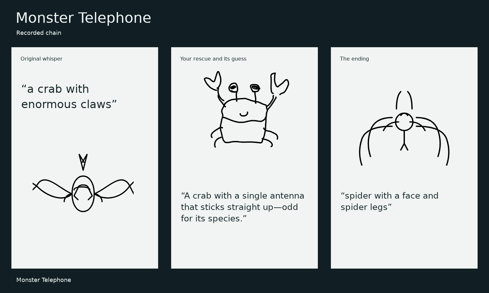
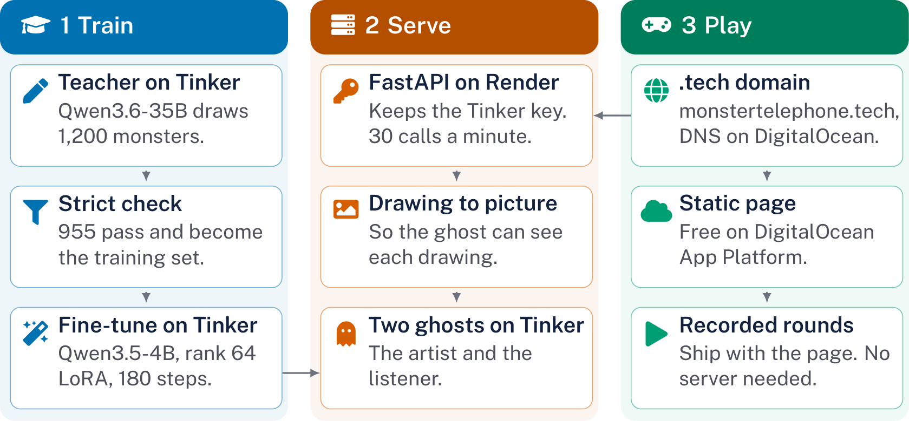

# Monster Telephone

[](https://monstertelephone.tech)
[](LICENSE)
[](https://github.com/ting-hong-shieh/monster-telephone/releases/tag/artist-2)
[](https://dev.to/elias-shieh/i-cant-draw-my-ai-ghosts-named-my-crab-then-turned-it-into-a-spider-2da6)

Telephone with monsters. You whisper a monster to a table of AI ghosts. One draws it, the next guesses from the drawing alone, and the story drifts. You are the only one who remembers the original, so at your turn you try to draw it back.

Play at [monstertelephone.tech](https://monstertelephone.tech).



## What is open

| Piece | Where | License |
| --- | --- | --- |
| Game page and server | [`site/`](site), [`server/`](server) | Apache-2.0 |
| Training and evaluation code | [`teach.py`](teach.py), [`learn.py`](learn.py) | Apache-2.0 |
| 955 training drawings, held-out prompts, results, recorded chains | [`data/`](data) | Apache-2.0 |
| Test rules, raw results, blind answers, every guess | [`tests/`](tests) | Apache-2.0 |
| Fine-tuned artist, a rank 64 LoRA adapter | [artist-2 release](https://github.com/ting-hong-shieh/monster-telephone/releases/tag/artist-2) | Apache-2.0 |
| Base models | [`Qwen/Qwen3.5-4B`](https://huggingface.co/Qwen/Qwen3.5-4B), [`Qwen/Qwen3.6-35B-A3B`](https://huggingface.co/Qwen/Qwen3.6-35B-A3B) | Apache-2.0 |
| Public Sans font | [`site/fonts/`](site/fonts) | [OFL](site/fonts/OFL.txt) |

The server calls [Tinker](https://tinker-docs.thinkingmachines.ai/), a hosted service, so the live game and training need a Tinker API key. I have not run the weights outside Tinker yet.

## How it works

The ghosts run on open-weight models through [Tinker](https://tinker-docs.thinkingmachines.ai/):

| Role | Model | Sees |
| --- | --- | --- |
| Artist | Qwen3.5-4B, fine-tuned | The whisper only |
| Listener | Qwen3.5-4B | The drawing as a picture, not the whisper |



| Path | What it does |
| --- | --- |
| `site/` | The static game, no build step |
| `server/app.py` | The API: `/api/draw`, `/api/whisper`, `/api/health` |
| `server/dev.py` | The page and the API together, for local play |
| `teach.py` | Has the large model draw and keeps what passes the check |
| `learn.py` | Fine-tunes the small model and evaluates the three models |
| `tests/` | The fixed test rules, scripts and results |

## The fine-tune

Qwen3.5-4B alone often fails to finish a clean line drawing. Qwen3.6-35B draws well but is larger. `teach.py` had the larger model draw 1,200 monsters and kept the 955 that passed a strict check. `learn.py` fine-tuned the small model on them with a rank 64 LoRA for 3 epochs.

Evaluation used 60 prompts about six creatures absent from training, sampled twice each:

| Model | Valid drawings | Mean tokens | Mean seconds |
| --- | --- | --- | --- |
| Qwen3.5-4B | 54 / 120 | 765 | 4.25 |
| Qwen3.5-4B, fine-tuned | 117 / 120 | 591 | 4.02 |
| Qwen3.6-35B | 92 / 120 | 830 | 5.38 |

Valid means the output parses, holds 3 to 14 unfilled paths, and stays within the canvas, inside a limit of 1,100 tokens. Most runs that failed for the first model hit that limit or broke the check. The seconds come from batched sampling and are rough.

Valid does not mean the drawing looks like the prompt. In a blind test, one rater named the creature from six choices for 2 of 30 fine-tuned drawings, 7 of 30 teacher drawings and 1 of 29 base drawings. Chance is about 5 of 30.

## Who can read a drawing

The listener first read SVG text. It named the right creature in 0 of 72 guesses. Reading a picture, it scored 0 of 54 on model drawings and 4 of 18 on six drawings by one person. Three of the four hits came from one crab, so this is a direction, not a rate. Rules and raw results are in `tests/`.

The training set, held-out prompts, results and recorded chains are in `data/`. One recorded chain uses a real player drawing. Every other chain has a ghost in the player's seat. Each was recorded once.

## Run it

### Watch a recorded round

No key and no server:

```bash
python3 -m http.server 4173 --directory site
```

Open `http://localhost:4173` and press "Watch one go wrong".

### Play a live round

Set `TINKER_API_KEY`, and set `ARTIST_PATH` to the sampler path saved by `learn.py`, then:

```bash
uv run --no-project --python 3.12 --with-requirements server/requirements.txt uvicorn dev:app --app-dir server --port 8000
```

Open `http://localhost:8000`. One round cost about $0.01 on Tinker when I checked.

### Train your own artist

Set `TINKER_API_KEY`, then:

```bash
uv run --no-project --with tinker --with transformers --with jinja2 python teach.py --out out/teach
uv run --no-project --with tinker --with transformers --with jinja2 python learn.py --data out/teach --rank 64 --out out/artist
```

The server in `server/` needs `ARTIST_PATH`, the sampler path saved by `learn.py`. The page in `site/` is static.

## Weights

The fine-tuned artist is a rank 64 LoRA adapter for `Qwen/Qwen3.5-4B`, Apache-2.0, in the [artist-2 release](https://github.com/ting-hong-shieh/monster-telephone/releases/tag/artist-2). The live game has run this checkpoint since 2026-10-31; the recorded chains on the site were drawn by the first training run. `learn.py` now saves a training checkpoint as well, because Tinker can only serve a sampler checkpoint. I retrained with the same data and settings so the weights could be exported. This run scored 118 of 120 valid drawings on the held-out prompts (`data/artist-2-results.json`). The first run scored 117 of 120. The blind test in `tests/` used the first run.

## Where it could go next

Issues and pull requests are welcome. These are the gaps I know about:

- **Run the weights outside Tinker.** The adapter has only been served by Tinker.
- **Widen what the artist can draw.** It trained on 38 kinds of creature and object, with no flowers among them. In four tries, "a flower" came out as spokes and circles.
- **Make the drawings recognizable.** The fine-tune taught the model to finish a drawing. The blind test could not show that it draws a goat.
- **Add ghosts.** Five characters share two models today.

## License

Apache-2.0.
